# Contributing

Found a bug or missing a feature in Claude Harness? The nine steps below take your change from your fork to a pull request that merges cleanly. Most of them are routine git, but step 6 matters most: merging the latest upstream master right before you open the PR keeps conflicts out.



## Getting started with contribution

Once you have cloned your fork, the repo's Claude Code commands run the remaining steps. Each command checks where you are, runs the commands listed under its step and stops when something needs you: uncommitted changes, a merge conflict or a failing test. Only you start them; Claude never runs one on its own.

| Command | Steps | What it does |
| --- | --- | --- |
| `/ext-contribute-setup` | 2 | Checks the remotes of your clone and adds `upstream`, once |
| `/ext-contribute-start <name>` | 3-4 | Branches off the owner's current master |
| `/ext-sideload [--new]` | 5 | Packages your change and installs it in VS Code |
| `/ext-contribute-sync` | 6, 8 | Merges the owner's master, tests and pushes |
| `/ext-contribute-pr` | 7 | Syncs, then opens the pull request |
| `/ext-contribute-finish` | 9 | Cleans up after the merge |

### Before you start: GitHub CLI

The steps use the [GitHub CLI](https://cli.github.com/) (`gh`). Install it when `gh --version` finds nothing:

```bash
winget install --id GitHub.cli   # Windows
brew install gh                  # macOS
```

On Linux, follow the [Linux installation guide](https://github.com/cli/cli/blob/trunk/docs/install_linux.md).

Optional: sign in to GitHub, when `gh auth status` says you are not logged in yet:

```bash
gh auth login
```

### 1. Fork the repository

Fork the repo on GitHub and clone your fork, never the owner's repo. `gh` does both; then open the clone in Claude Code:

```bash
gh repo fork alexander-kastil/claude-harness --clone
cd claude-harness
claude
```

### 2. Configure the remotes

Run `/ext-contribute-setup`. It checks that your clone has two remotes:

- `origin` = the fork, aeshilion/claude-harness
- `upstream` = alexander-kastil/claude-harness

When you cloned your fork without gh, it adds the missing remote:

```bash
git remote add upstream https://github.com/alexander-kastil/claude-harness.git
```

## Contributing a change

### 3. Synchronize master

`/ext-contribute-start <name>` runs steps 3 and 4:

```bash
git checkout master
git pull --ff-only upstream master
git push origin master
```

### 4. Create a feature branch

```bash
git checkout -b feature/<name>
```

### 5. Implement, commit and test

The work and the commits are yours; no command writes or commits code.

```bash
npm ci
npm run compile
npm test
```

To try the change in VS Code, `/ext-sideload` packages it and installs it in your VS Code. `/ext-sideload --new` installs it in a separate VS Code instance instead and opens the repo there.

### 6. Merge upstream master before the pull request

This is the step that avoids conflicts. `/ext-contribute-sync` runs it and stops on a conflict or a failing test:

```bash
git fetch upstream
git merge upstream/master
# resolve any conflict locally, then check again
npm ci  # only when the merge changed package-lock.json
npm test
git push -u origin HEAD
```

### 7. Open the pull request

`/ext-contribute-pr` runs the sync first, then opens the PR with "Allow edits by maintainers" on. The title and description come from your commits.

```bash
gh pr create --repo alexander-kastil/claude-harness --base master --head aeshilion:feature/<name> --title "<title>" --body-file <file>
```

### 8. Keep the pull request up to date

Repeat step 6 with `/ext-contribute-sync`. The PR updates itself.

### 9. Clean up after the merge

`/ext-contribute-finish` checks that the PR merged before it deletes anything:

```bash
git checkout master
git pull --ff-only upstream master
git branch -d feature/<name>
git push origin --delete feature/<name>
```
