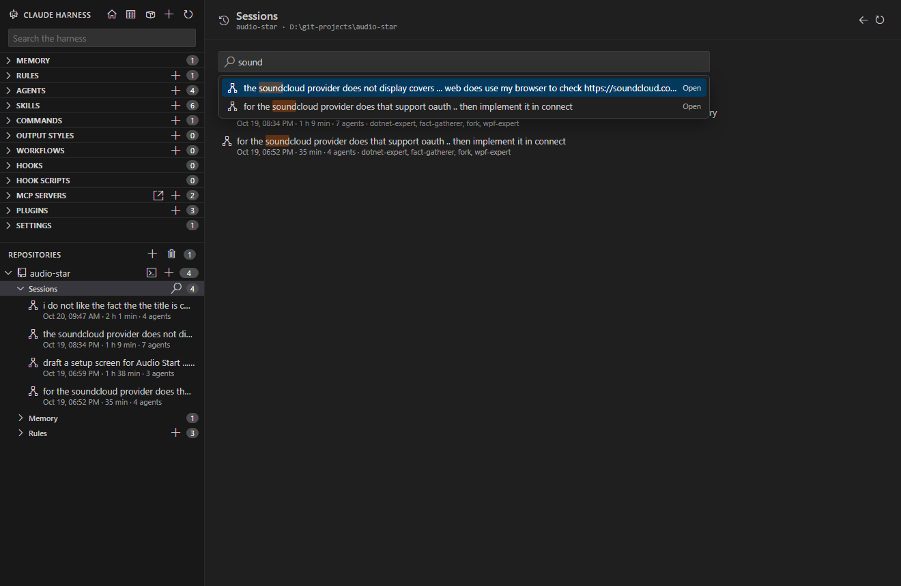
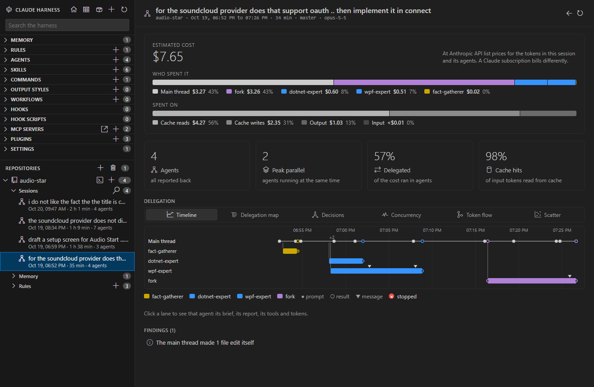
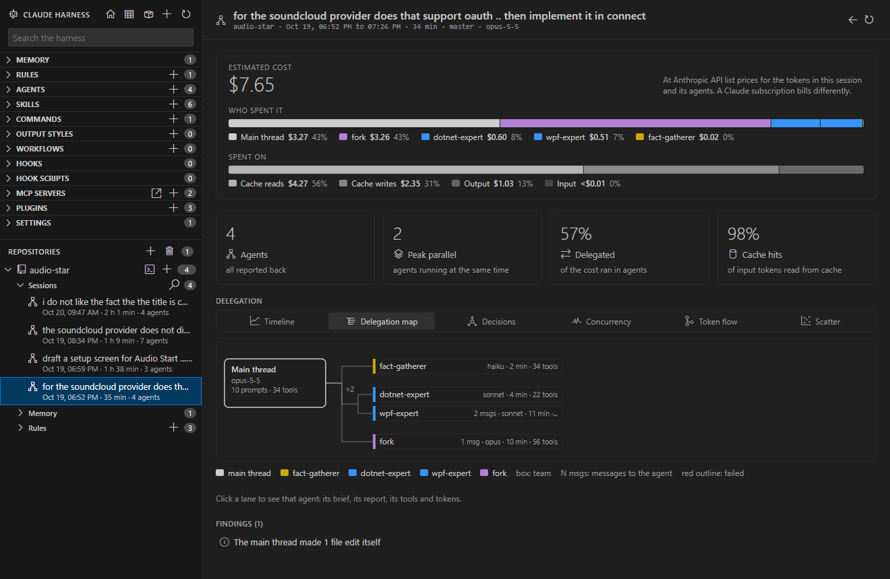
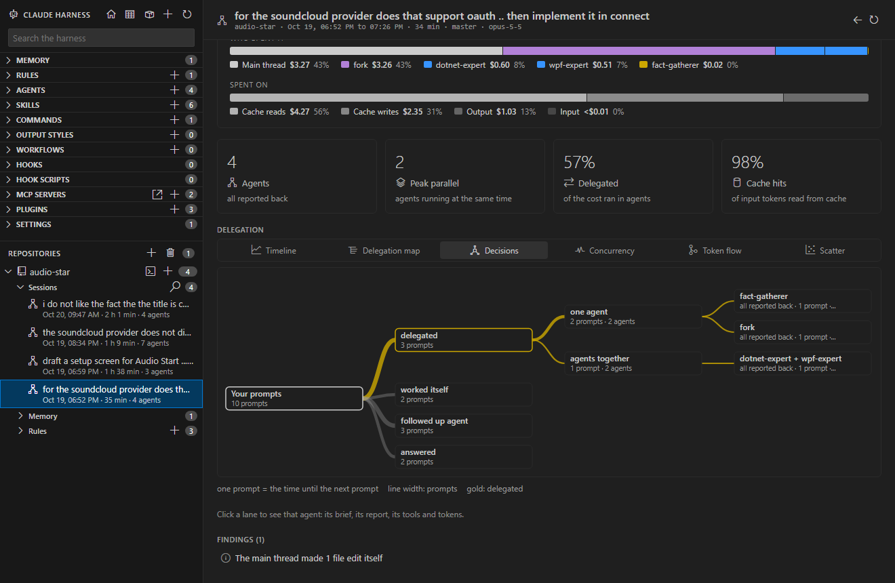
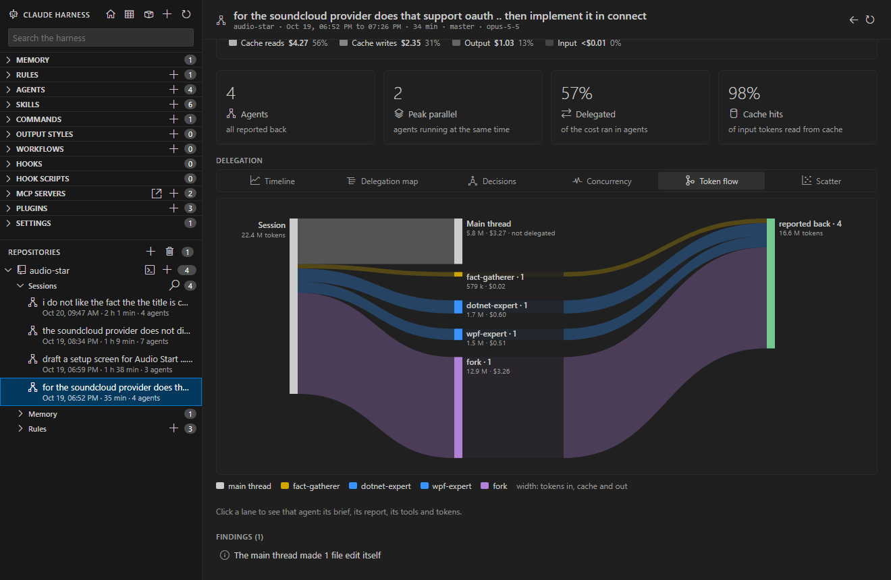
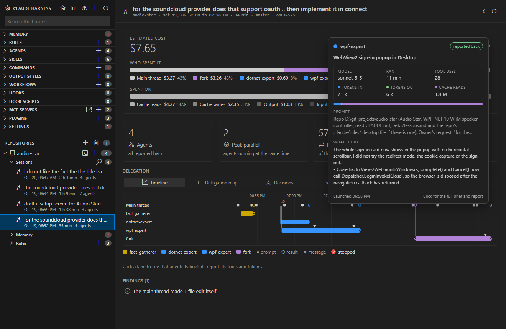

# Sessions

<table width="100%" border="1" cellpadding="10" cellspacing="0">
<tr>
<td align="left"><a href="repositories.md">← Back to Repositories</a></td>
<td align="center"></td>
<td align="right"><a href="../README.md#features">↑ Back to Features</a></td>
</tr>
</table>

Claude Harness lists the Claude Code sessions that ran in each repo. A session page shows what the run cost, which agents it started and how the work was delegated. Open a session from the activity bar, the main window or a repo page.

| Section | Description |
| --- | --- |
| [Sessions in the tree](#sessions-in-the-tree) | The session rows under each repo in the activity bar |
| [Sessions page](#sessions-page) | The search box, its suggestions, filters and chips |
| [Session page](#session-page) | The header, the cost, the four KPIs and the agent details |
| [Delegation views](#delegation-views) | The six views of how the work was delegated |
| [Hover cards](#hover-cards) | The cards for agents, the main thread and repos |

## Sessions in the tree

Each repo in the activity bar expands to its sessions, newest first. A session row shows its first prompt, its date, its duration, its agent count and whether it is running now. Headless `claude -p` runs started from a session's scratchpad folder appear under that session.

Click a session row to open its session page. The **Open Session** command runs from these rows. See [Commands](commands.md).

## Sessions page

An open repo in the main window shows a **Sessions** node first, above **Memory**, with its count. Click the label or the search icon to open the Sessions page. The chevron expands the 10 newest sessions inline, with **Show all**. A repo page has the same 10 newest sessions in its own **Sessions** section. See [Main window](main-window.md#sidebar) and [Repositories](repositories.md#repository-page).

The Sessions page has one search box. Suggestions appear when you focus it, and they narrow as you type:

| Suggestion | Narrows to |
| --- | --- |
| Running now | Sessions that are running |
| Started today | Sessions that started today |
| With agents | Sessions that started at least one agent |
| With headless runs | Sessions that have headless `claude -p` runs |
| `Agent: <type>` | Sessions with an agent of that type |
| `Branch: <name>` | Sessions on that branch |
| Matching sessions | Sessions whose text matches what you typed. Choose one to open it. |

A chosen filter becomes a chip. Press Backspace in an empty box to remove the last chip. Press Esc to clear the text and all chips. Matches are highlighted in the results.

## Session page

The header shows the repo, the start and end, the duration, the branch and the model. Below it, the cost row shows an estimated cost at Anthropic API list prices. A Claude subscription bills differently. Two bars split the cost by **Who spent it** (the main thread and each agent type) and by **Spent on** (cache reads, cache writes, output and input).

The **Billing** switch in the cost row shows the same cost as a share of one weekly limit of your plan: Pro, Max 5x, Max 20x, Team Standard, Team Premium, or API billing for dollars. Anthropic publishes no figure for a weekly limit, so the limits are estimates, marked with `*`. Max 5x, Max 20x and Team Premium come from third-party measurements. Pro and Team Standard are derived as one fifth of Max 5x and of Team Premium, following the plan prices. Team plans expose no rate limits to Claude Code's status line, so the share cannot be read from there.
Four KPIs follow the cost row:

| KPI | Shows |
| --- | --- |
| Agents | The agent count, with the count of failed or without-report agents |
| Peak parallel | The most agents that ran at the same time |
| Delegated | The share of the cost that ran in agents |
| Cache hits | The share of input tokens read from cache |

Below the KPIs, the **Delegation** section shows how the work was split. Then come the agent details, the findings and, when there are any, the headless runs. Click a lane or a node in the delegation views to see that agent's brief, report, tools and tokens.

## Delegation views

The Delegation section has six views behind one toggle bar. Each toggle shows a short hover. A legend under the diagram explains its marks.

| View | Shows |
| --- | --- |
| Timeline | A lane per agent, next to your prompts. A red circle with a white x marks a stopped agent. |
| Delegation map | Who started which agent. Its **Sum** and **Full timeline** modes are described below. |
| Decisions | What happened after each prompt: delegated, worked itself, followed up an agent, or answered. Its **Sum** and **Full timeline** modes are described below. |
| Concurrency | The agents that ran at the same time. Each agent run is one bar in its own lane, so the height is the number of agents running, and the peak is marked. |
| Token flow | The tokens from the session, through the main thread and each agent type, to the outcome. |
| Scatter | Each agent by run time and tokens. Dot area is the agent's cost, and the costliest dots are drawn first so smaller ones stay visible. Dashed lines are medians. Both scales are logarithmic. |

Lane colors come from the agent definition's own color field, or from the color a teammate was given. A type without its own color takes a palette hue that no named type uses, for as long as one is left. Types that share a hue get a lighter and a deeper shade of it.

### Delegation map

The map shows who started each agent. Use it to follow a chain of agents back to the main thread. Two buttons above the diagram switch its mode. Each button shows a short hover.

| Mode | Shows |
| --- | --- |
| Sum | Agents summed up by type under whoever started them. Click a type to drill down to its runs. |
| Full timeline | Your prompts as a process from top to bottom. Each delegation branches into the agents it started, and their reports join the main thread again. A team that ran together forks at a parallel gateway beside its prompt. |

The Full timeline opens by default. Every row, a type or a run, shows the same four facts in fixed right-aligned columns: the model (the runs for a type), the run time, the tool uses and the messages. A value of zero or `-` still shows.

### Decisions

The Decisions view shows what the main thread did after each of your prompts. Two buttons above the diagram switch its mode. Each button shows a short hover.

| Mode | Shows |
| --- | --- |
| Sum | Your prompts summed up by what the main thread did, which agent or team it used, and how that ended. This is the default. |
| Full timeline | Every prompt in order, with what the main thread did, the agent it launched or its team, and each team member. |

Click a node with a `▸` to open it and see what is below it. Click a node with a `▾` to fold it again. The Sum mode opens its first three levels, and the Full timeline opens every level.

### Token flow

The Token flow view traces the tokens from the session to the outcome.

## Hover cards

Hover an agent lane to see its card. It shows the agent type and teammate name, the status, the description, the model, the run time, the tool uses, the tokens in and out, and the cache reads with a bar. It also shows 3 lines of the prompt and 6 lines of what it did, which is the agent's report. A fork lane adds a note on what a fork is.

The card on the **Main thread** lane shows the model, the run time, the prompt count, the tool uses, the file edits, the agents started, the tokens, the top tools and the estimated cost.

Hovering a repo row in the main window sidebar shows a card with the repo path, its check status (with a harness standard provider), its harness item counts, its session and agent totals, and the first prompt of its latest session.

---

<table width="100%" border="1" cellpadding="10" cellspacing="0">
<tr>
<td align="left"><a href="repositories.md">← Back to Repositories</a></td>
<td align="center"><a href="#sessions">↑ Back to top</a></td>
<td align="right"><a href="../README.md#features">↑ Back to Features</a></td>
</tr>
</table>
