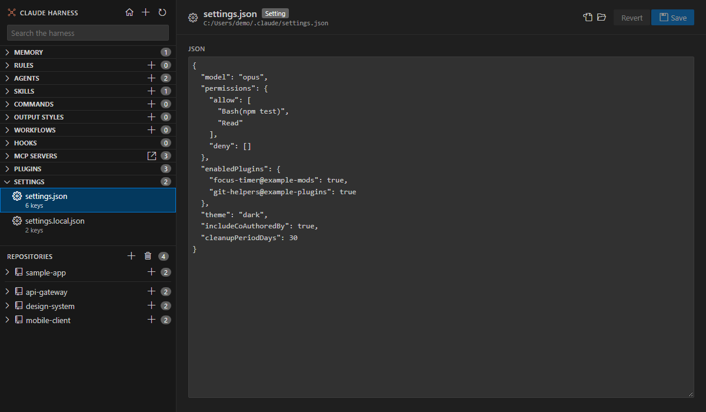

# Settings

<table width="100%" border="1" cellpadding="10" cellspacing="0">
<tr>
<td align="left"><a href="plugins.md">← Back to Plugins</a></td>
<td align="center"></td>
<td align="right"><a href="../README.md#features">↑ Back to Features</a></td>
</tr>
</table>

Three VS Code settings control what Claude Harness lists. Find them under **Claude Harness** in the Settings editor. The two repo lists are stored in your user settings. Use **Add Repo** and **Remove Repo** to change them, because those commands update the settings for you.

| Setting | What it does | Default |
| --- | --- | --- |
| `claudeHarness.root` | The folder of the global harness. Empty means `~/.claude`. | Empty |
| `claudeHarness.repoFolders` | Folders added with **Add Repo**. Each is a repo folder or a parent folder. | `[]` |
| `claudeHarness.removedRepos` | Repo folders hidden with **Remove Repo**. Adding the repo or its parent folder again shows it. | `[]` |

Changing `claudeHarness.root` reloads the global harness from the new folder, and the new folder is watched for changes.

See [Repositories](repositories.md) for how the two repo lists are used.

## Edit settings files

The **Settings** category lists `settings.json` and `settings.local.json` for the global harness and for each repo, when the file exists. Click a file to open it in an editable JSON box.

| Action | How |
| --- | --- |
| Save | Click **Save**, or press Ctrl+S. Save is available only when the text has changed. |
| Revert | Click **Revert** to drop your changes |

Save checks the JSON first. Invalid JSON shows an error with the parser message, and the file stays unchanged. The file keeps its line endings, whether they are CRLF or LF.

---

<table width="100%" border="1" cellpadding="10" cellspacing="0">
<tr>
<td align="left"><a href="plugins.md">← Back to Plugins</a></td>
<td align="center"><a href="#settings">↑ Back to top</a></td>
<td align="right"><a href="../README.md#features">↑ Back to Features</a></td>
</tr>
</table>
